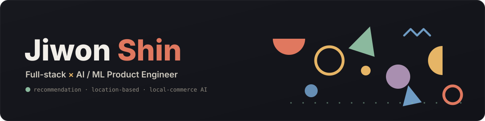



  
    
  <a href="mailto:syrima03@gmail.com">Email</a>
  &nbsp; / &nbsp;
  <a href="#experience">Experience</a>
  &nbsp; / &nbsp;
  <a href="#tech-stack">Tech Stack</a>

 

## 안녕하세요, 신지원입니다

**업무를 이해하고, 실제로 쓰이는 기능을 만드는 개발자입니다.**

운영 중인 서비스의 주문·결제 흐름을 개선하고, 추천 모델을 웹 서비스에 연결하며, 흩어진 업무를 관리하는 SaaS를 개발하고 있습니다. 화면부터 API, 데이터베이스, 배포까지 필요한 영역을 맡아 구현합니다.

조직의 비공개 저장소에서 주로 협업합니다. 아래에는 그동안 맡은 역할과 구현 내용을 정리했습니다.

日本語で読む

 

**業務を理解し、実際に使われる機能をつくるエンジニアです。**

運用中のサービスの注文・決済フローを改善し、推薦モデルをWebサービスに組み込み、業務を管理するSaaSを開発しています。画面からAPI、データベース、デプロイまで、必要な領域を担当しています。

主に組織の非公開リポジトリでチーム開発を行っています。以下に、担当した役割と実装内容をまとめています。

 

<h2 id="experience">Experience</h2>

### 01 / 커머스 서비스 개발

운영 중인 서비스에서 **기능 개발과 유지보수**를 담당했습니다.

- 주문·배송 정보, 포인트 적립, 선물하기와 부분 취소 흐름 구현
- 상품·예약 통합검색과 사용자 화면 개선, Java API 개발
- 테스트 환경 배포와 CI 구성

Next.js · TypeScript · Spring Boot · MySQL

### 02 / 추천·위치 기반 AI

**개발자 겸 PL**로 추천 모델과 서비스 연동을 설계·구현하고, 진행 관리와 기술적 의사결정을 맡았습니다. 현재 출시 전 단계입니다.

- LightGBM 랭킹과 ALS 협업 필터링을 활용한 추천 기능
- 위치·날씨를 반영한 여행 경로와 코스 저장·공유
- Whisper LoRA를 활용한 음성인식과 상품 등록 지원
- 기존 업무 DB의 읽기 접근과 AI 서비스 분리, 행동 로그 수집·재학습 구조

Python · FastAPI · LightGBM · implicit ALS · Whisper · MongoDB

### 03 / 멀티테넌트 운영 SaaS

고객 요구사항을 정리하고 **화면 설계부터 프론트엔드·백엔드 구현**까지 참여하고 있습니다.

- 회원·조직 관리, 이벤트·재고 관리와 QR 출석 기능
- 사용자·운영자·본사 화면과 Go API 개발
- 다국어 문구 분리, 스키마 기반 API 타입 생성
- 외부 QA와 요구사항 및 검증 범위 조율

Next.js · Go · Gin · sqlc · PostgreSQL · Redis

### 04 / 현장 운영 도구

**스포츠 대회 랭킹과 관리 시스템**에서 Java 백엔드와 개인전·단체전 순위 집계를 담당했습니다. 실제 대회 현장에서 사용되었습니다.

얼굴인식 출석 기능도 단독 개발했으며, 장비 준비 문제로 현장 운영은 보류되었습니다. 별도로 웹 편집기와 재생 스케줄을 갖춘 **전자게시판**을 개발해 교내 TV에서 운영했습니다.

Next.js · Java · MongoDB · CompreFace · Supabase · Raspberry Pi

 

<h2 id="tech-stack">Tech Stack</h2>

| 영역 | 사용 기술 |
| :--- | :--- |
| Frontend | TypeScript, React, Next.js, Tailwind CSS, shadcn/ui |
| Backend | Java, Spring Boot, Go, Gin, Python, FastAPI |
| Data | PostgreSQL, MySQL, MongoDB, Redis, Supabase |
| AI / ML | LightGBM, LambdaMART, implicit ALS, Whisper LoRA |
| Infra | Docker, GitHub Actions, AWS, Vercel |

 

## How I work

**요구사항을 기능과 데이터 구조로 정리합니다.** 주문·결제나 조직별 권한처럼 업무 흐름을 먼저 이해하고, 화면과 API가 같은 규칙을 따르도록 설계합니다.

**구현 후 실제 동작을 확인합니다.** 테스트와 화면 검증을 함께 진행하고, 기존 서비스에 미치는 영향과 배포 이후의 운영도 고려합니다.

**AI 도구를 개발 과정에 활용합니다.** Skills와 MCP로 조사·구현·검증 절차를 정리합니다. 핵심 구조는 직접 판단하고, 생성된 코드도 리뷰와 검증을 거칩니다.

日本語 / 開発で大切にしていること

 

業務の流れを理解してから、要件を機能とデータ構造に整理します。画面とAPIのルールを合わせ、テストと実際の画面で動作を確認します。

AIツールも開発に活用し、SkillsとMCPで調査・実装・検証の手順を整えています。中核となる設計は自分で判断し、生成されたコードもレビューと検証を行います。

---

  신지원 / Shin Jiwon / シン・ジウォン 
  <a href="mailto:syrima03@gmail.com">syrima03@gmail.com</a>

