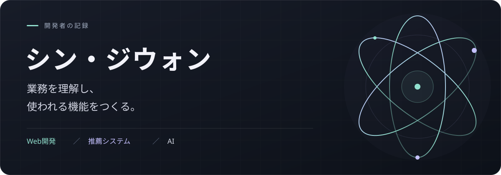



  
    
  <a href="#紹介">紹介</a> &nbsp; ／ &nbsp; <a href="#開発経験">開発経験</a> &nbsp; ／ &nbsp; <a href="#技術">技術</a> &nbsp; ／ &nbsp; <a href="mailto:syrima03@gmail.com">連絡する</a>

 

## 紹介

**業務を理解し、実際に使われる機能をつくるエンジニアです。**

運用中のECサービスの機能開発、推薦・音声認識のサービス連携、マルチテナントSaaSの開発に取り組んでいます。画面からAPI、データベース、デプロイまで、必要な領域を担当しています。

主な開発の場は、組織の非公開リポジトリです。ここでは担当した役割と実装内容を紹介します。

 

## 開発経験

### 01　ECサービスの開発・保守

注文や決済が日々動くサービスで、**既存の業務フローを理解したうえで機能を改善**しました。

- 注文・配送情報、ポイント還元、ギフト購入と部分キャンセル
- 商品・予約の横断検索、利用者向け画面とJava APIの開発
- テスト環境へのデプロイとCIの整備

Next.js ／ TypeScript ／ Spring Boot ／ MySQL

### 02　推薦・位置情報・音声認識

**開発者兼プロジェクトリーダー**として、モデルの設計からサービスへの組み込みまで担当しています。進行管理と技術的な意思決定も担っています。

- LightGBMによるランキングとALS協調フィルタリング
- 位置情報・天気を反映した旅行ルート、コースの保存・共有
- Whisper LoRAによる音声認識と商品登録の支援
- 既存業務DBへのアクセスを読み取りに限定したAIサービスの分離
- 行動ログの収集とモデルの再学習

Python ／ FastAPI ／ LightGBM ／ implicit ALS ／ Whisper ／ MongoDB 
※ AI機能はリリース前です。

### 03　マルチテナントSaaS

顧客の要件を整理し、**画面設計とフロントエンド・バックエンドの実装**に参加しています。

- 会員・組織、イベント・在庫の管理とQRコードによる出席記録
- 利用者・運営者・本部向けの画面とGo API
- 多言語対応とスキーマからのAPI型生成
- 外部QA担当者との要件・検証範囲の調整

Next.js ／ Go ／ Gin ／ sqlc ／ PostgreSQL ／ Redis

### 04　現場で使うシステム

**スポーツ大会のランキング・管理システム**では、Javaバックエンドと個人戦・団体戦の順位集計を担当しました。実際の大会で運用されました。

顔認識による出席機能も単独開発しました。機能は完成していますが、機材が用意できず、現場での運用は保留中です。

別途、ブラウザ上の編集機能と再生スケジュールを備えた**電子掲示板**を単独開発し、学内のテレビで運用しました。

Next.js ／ Java ／ MongoDB ／ CompreFace ／ Supabase ／ Raspberry Pi

 

## 技術

| 領域 | 使用技術 |
| :--- | :--- |
| フロントエンド | TypeScript, React, Next.js, Tailwind CSS, shadcn/ui |
| バックエンド | Java, Spring Boot, Go, Gin, Python, FastAPI |
| データベース | PostgreSQL, MySQL, MongoDB, Redis, Supabase |
| AI・機械学習 | LightGBM, LambdaMART, implicit ALS, Whisper LoRA |
| インフラ・運用 | Docker, GitHub Actions, AWS, Vercel |

 

## 開発で大切にしていること

**業務から設計する。** 注文・決済や組織別の権限など、実際の業務を理解してから機能とデータ構造を整理します。画面とAPIが同じルールで動くことを大切にしています。

**動作を確かめ、運用まで考える。** テストと実際の画面で検証し、既存サービスへの影響やデプロイ後の保守も確認します。

**AIを活用し、判断に責任を持つ。** SkillsとMCPで調査・実装・検証の手順を整えています。中核となる設計は自分で判断し、生成されたコードもレビューと検証を行います。

 

  
    
  シン・ジウォン 
  <a href="mailto:syrima03@gmail.com">syrima03@gmail.com</a>

